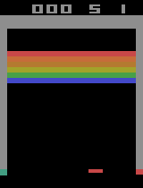

# Deep Q-Network for Atari Breakout

<p align="center">
  
</p>

## Overview

This project implements a Deep Q-Network (DQN) agent to learn to play Atari Breakout using reinforcement learning. The agent learns a policy through interaction with the environment, using observed states and rewards to improve its action selection over time.

The implementation uses PyTorch for neural network training and Gymnasium with the Arcade Learning Environment (ALE) to simulate Atari Breakout. To improve training throughput, multiple environments are executed in parallel. A replay buffer stores transitions for off-policy learning, while a separate target network stabilizes the temporal-difference learning process.

The project includes training and evaluation scripts, visualization tools, test utilities, training logs, and saved model checkpoints.


## Methodology

### Deep Q-Network

The agent approximates the action-value function \(Q(s,a)\), which estimates the expected discounted return from taking action \(a\) in state \(s\). The policy selects actions based on these estimates, with an epsilon-greedy strategy balancing exploration and exploitation.

The neural network consists of convolutional layers for spatial feature extraction, followed by fully connected layers that predict action values. Training uses temporal-difference targets and a separate target network.

### State representation

The environment's RGB observations are converted into binary images of size 84 × 84. Four consecutive frames are stacked to provide temporal information about the game's dynamics, including the movement of the ball and other objects.

### Experience replay

Transitions are stored in a replay buffer and sampled in mini-batches during training. This reduces the dependence between consecutive observations and supports reuse of previously collected experience.

### Parallel environments

Multiple Breakout instances run concurrently to increase the number of environment interactions collected during training. Episode statistics and training metrics are recorded to enable subsequent evaluation and visualization.

## Repository Structure

```text
.
├── src/
│   ├── dqn.py              # DQN neural network implementation
│   ├── evaluate.py         # Model evaluation
│   ├── plot_training.py    # Training metric visualization
│   ├── replay_buffer.py    # Experience replay buffer
│   ├── test_dqn.py         # DQN-related tests
│   ├── test.py             # Additional tests or validation
│   └── train.py            # Main training procedure
│
├── results/
│   ├── *.csv               # Training logs and episode statistics
│   ├── *.json              # Training configuration and parameters
│   └── *.png               # Generated plots
│
├── models/
│   ├── *.pth               # Trained model weights and checkpoints
│   └── ...
│
├── assets/
│   └── breakout_demo.gif   # Gameplay demonstration
│
└── README.md
```

### Source files

| File | Description |
|---|---|
| `dqn.py` | Defines the neural network used to approximate the action-value function. |
| `evaluate.py` | Provides functionality for evaluating a trained agent. |
| `plot_training.py` | Generates visualizations of training progress from recorded results. |
| `replay_buffer.py` | Implements storage and sampling of experience transitions. |
| `test_dqn.py` | Contains tests related to the DQN implementation. |
| `test.py` | Provides additional tests or validation utilities. |
| `train.py` | Coordinates environment interaction, experience collection, optimization, logging, and checkpointing. |

## Training Configuration

The training setup includes the following principal parameters:

| Parameter | Value |
|---|---:|
| Number of parallel environments | 25 |
| Input image size | 84 × 84 |
| Number of stacked frames | 4 |
| Replay buffer capacity | 100,000 transitions |
| Batch size | 96 |
| Discount factor (\(\gamma\)) | 0.985 |
| Learning rate | 0.0001 |
| Initial exploration rate (\(\epsilon\)) | 1.0 |
| Minimum exploration rate | 0.01 |
| Exploration decay schedule | 300,000 environment steps |
| Learning start threshold | 80,000 transitions |
| Gradient updates per vectorized step | 2 |
| Target network update frequency | 10,000 environment steps |
| Maximum episode length | 10,000 steps |

These values describe the configuration in the training implementation and can be adjusted to investigate their effects on learning performance.

## Installation

Python, PyTorch, Gymnasium, ALE, NumPy, and Matplotlib are required for the main workflow. Install a PyTorch build appropriate for your hardware, particularly if GPU acceleration is desired.

Create and activate a virtual environment, then install the dependencies:

```bash
python -m venv .venv
```

On Windows:

```powershell
.\.venv\Scripts\Activate.ps1
```

On Linux or macOS:

```bash
source .venv/bin/activate
```

Install the required packages:

```bash
pip install torch gymnasium ale-py numpy matplotlib
```

Depending on the implementation of the auxiliary scripts, additional packages may be required.

## Usage

Run the commands below from the repository root.

### Training

Start the training procedure with:

```bash
python src/train.py
```

The training script initializes the environments and networks, collects experience, updates the policy network, periodically synchronizes the target network, and records training statistics.

Training output is stored in `results/`, while model checkpoints are saved in `models/`.

### Evaluation

Evaluate a trained agent using:

```bash
python src/evaluate.py
```

Use the model path and any configuration options expected by the evaluation script.

### Plotting training results

Generate visualizations from the recorded training data:

```bash
python src/plot_training.py
```

The resulting plots can be used to examine learning progress and episode-level performance.

### Tests

Run the test scripts with:

```bash
python src/test_dqn.py
python src/test.py
```

The precise checks performed depend on the implementation of each script.

## Results and Model Checkpoints

The `results/` directory contains the recorded training data and visualizations. The CSV logs capture episode-level quantities such as reward, episode length, exploration rate, average loss, replay buffer size, remaining lives, and termination reason. The JSON configuration records the parameters used for training.

The `models/` directory stores trained model weights and checkpoints. These files support evaluation of saved agents without requiring a complete retraining run.

The GIF at the beginning of this README provides a qualitative demonstration of the agent's behavior. Training logs and plots provide complementary quantitative information about its learning progress.

## Reproducibility

The recorded configuration and training logs provide a basis for comparing training runs. However, exact reproducibility may depend on random seeds, software versions, hardware, and the behavior of parallel environments.

For meaningful comparisons, keep the environment configuration and hyperparameters consistent and record any changes between experiments.

## Note
ChatGPT was used as a supporting tool during the development of this project, mainly for coding assistance, debugging, documentation, and formatting. The implementation, testing, and integration of the project were carried out by the author.